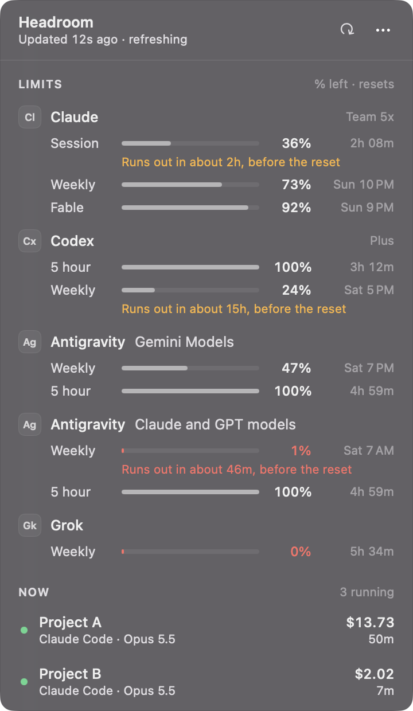
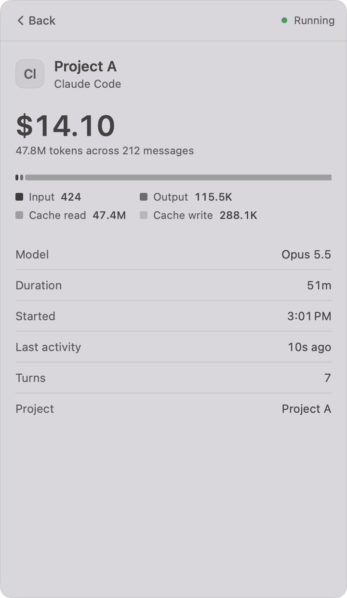

# Headroom

A small macOS menu bar app that shows how much room you have left on your AI coding plans.

The menu bar shows one ring and one number: the limit closest to running out, across every provider. Click it for the full picture.

<p>
  
  
</p>


Project names in these screenshots are hidden with `HEADROOM_REDACT=1`.

## What it shows

- **Limits.** One block per provider and quota group (Claude, Codex, Antigravity's Gemini and Claude/GPT groups, Grok, Cursor, anything tokscale reports). Each limit has a thin bar, % left and when it resets. When your pace says a limit runs out before it resets, it says "Runs out in about 3h".
- **Now.** Agent sessions that wrote a message in the last five minutes: project, model, elapsed time, cost so far.
- **Today.** Total cost and tokens, the last seven days as small bars, and today's top model.
- **Sessions.** Today's sessions. Click one for tokens in, out and cache, cost, duration, model and project.

The pill is grey normally, amber under 20% left and red under 5% left. Choose which providers count toward the pill in the `…` menu.



## How it works

Headroom does not read any provider itself. It runs [tokscale](https://github.com/junhoyeo/tokscale), a Rust CLI with accurate quota and session data, and draws its JSON:

| Section | Command | How often |
|---|---|---|
| Limits | `tokscale usage --json` | every 60 s and when the panel opens |
| Today | `tokscale graph --week` | every 3 min and when the panel opens |
| Now, Sessions | `tokscale sessions --json --today` | every 3 min and when the panel opens |

Every call runs off the main thread with a timeout. The last reading is saved to `~/Library/Application Support/Headroom/`, so the panel never goes blank: it shows "Updated 40s ago" instead. The forecast uses your recent pace when Headroom has seen a reading 15 to 90 minutes earlier, and the average pace since the window opened otherwise.

## Install

Requirements: macOS 14 or later, Xcode command line tools, and a tokscale build with the `sessions` command.

```bash
# 1. tokscale with `sessions --json` (until it ships upstream)
git clone https://github.com/stevmolina/tokscale && cd tokscale
git checkout integration/headroom
cargo build --release -p tokscale-cli
mkdir -p ~/.local/bin && cp target/release/tokscale ~/.local/bin/

# 2. Headroom
git clone https://github.com/stevmolina/headroom && cd headroom
scripts/bundle.sh          # builds Headroom.app, installs to ~/Applications and opens it
```

Headroom looks for tokscale in `~/.local/bin`, `/opt/homebrew/bin`, `/usr/local/bin` and `~/.cargo/bin`, or at `$HEADROOM_TOKSCALE`.

On macOS 27 a new menu bar item starts in the hidden overflow (the `»` button). Cmd-drag the pill into the bar once, or place it with your menu bar manager.

## Develop

```bash
swift build        # debug build
swift test         # unit tests: date parsing, model names, burn-rate forecast
swift scripts/make-icon.swift && iconutil -c icns build/AppIcon.iconset -o Resources/AppIcon.icns
```

Environment switches: `HEADROOM_REDACT=1` hides project names, `HEADROOM_AUTOMATION=1` lets a script open the panel and step through it with distributed notifications named `dev.stevmolina.headroom.automation` (`open`, `scroll:sessions`, `session:0`, `back`, `close`), without touching the mouse.

## License

MIT
